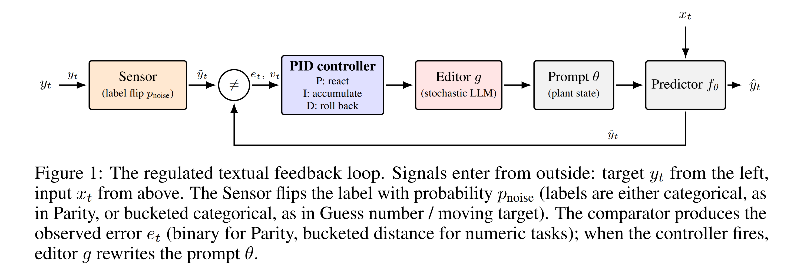
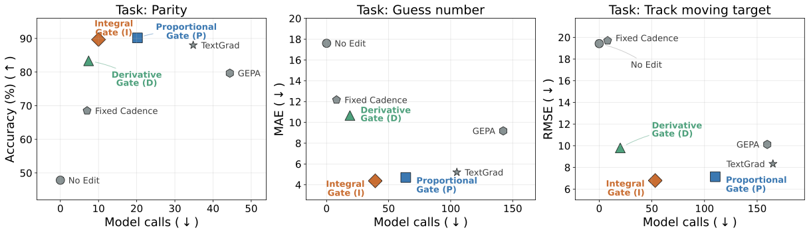

# pid-gated-agent-learning

[](https://neurips.cc/virtual/2026/loc/sydney/workshop/137501)
[](https://www.python.org/)
[](https://opensource.org/licenses/Apache-2.0)
[](https://github.com/astral-sh/ruff)

> **Official implementation of**
> **[PID-Gated Continual Prompt Adaptation Under Noisy Feedback](https://neurips.cc/virtual/2026/loc/sydney/workshop/137501)**
> — *NeurIPS 2026 Workshop, Sydney.*
>
> 📄 Camera-ready PDF: [`paper/pid_gated_continual_prompt_adaptation.pdf`](paper/pid_gated_continual_prompt_adaptation.pdf)

Control-theoretic **scheduling** for continual LLM prompt adaptation under noisy feedback.
When should an agent revise its instructions in response to feedback that may itself be
wrong? This library offers three lightweight **gates** — Proportional, Integral, and
Derivative — that decide *when* to invoke an LLM-based prompt editor, with any provider
(OpenAI, Anthropic, Gemini, DeepSeek, Ollama, or your own).

**TL;DR** — on three drifting benchmarks, the Integral gate matches TextGrad-quality
prompt editing while issuing roughly **2.7–3.5× fewer LLM calls**. Defaults to OpenAI;
swap in any provider via a one-method `generate(prompt, system=None) -> str` interface.

## Contents

**Run it**
- [Get started](#get-started)
- [Reproducing the paper](#reproducing-the-paper)
- [Install as a library](#install-as-a-library)

**Understand it**
- [Why PID?](#why-pid)
- [Gates](#gates)
- [Tasks](#tasks)

**Hack on it**
- [Development](#development)
- [Testing & cross-platform compatibility](#testing--cross-platform-compatibility)
- [Contributing](#contributing)

**Reference**
- [Citation](#citation)
- [License](#license)

## Get started

Three commands on macOS, Linux, or WSL:

```bash
git clone https://github.com/zhentao-xu/pid-gated-agent-learning.git
cd pid-gated-agent-learning
bash ./scripts/setup.sh
```

That's it. The wizard installs `uv` if you don't have it, picks a Python
version, prompts you for the API keys of whichever providers you want to use,
runs `uv sync`, and offers to launch the quickstart notebook.

<details>
<summary><b>What the wizard looks like</b> (click to expand)</summary>

```text
▸ Detecting platform
  ✓ macOS (arm64)

▸ Checking uv
  ✓ uv found: uv 0.11.32

▸ Pick a Python version
    *   1) 3.13 (latest supported)
        2) 3.12
        3) 3.11
        4) 3.10 (minimum)
        5) auto (let uv decide)
  ? Which Python? (1-5, default=1)

▸ Configure LLM providers
  ? Configure OpenAI? [Y/n]
  ?   OPENAI_API_KEY (hidden):          # input is masked
  ? Configure Anthropic? [y/N]
  ✓ .env written (chmod 600, 2 vars)

▸ Installing dependencies with uv sync
  ✓ dependencies installed

▸ Running smoke tests
  ✓ pytest green (10 passed)

▸ Launch the quickstart notebook?
  ? Open examples/quickstart.ipynb in Jupyter now? [Y/n]
```

What it does under the hood:
- Detects **macOS / Linux / WSL / Git Bash** and exits gracefully elsewhere.
- Offers to install `uv` via **brew / curl / wget / pipx / pip** — whichever is actually on your system. No assumptions.
- Writes a `chmod 600` `.env` in the repo root (gitignored). Hidden input via `stty -echo`.
- Sources `.env` into the shell before launching Jupyter, so the kernel sees your keys.
</details>

Prefer not to use the wizard? See [Install as a library](#install-as-a-library) or [Development](#development) below.

## Reproducing the paper

The full end-to-end experiments from the paper — three drifting tasks × three
gates × five providers — run from
[`examples/quickstart.ipynb`](examples/quickstart.ipynb). Rerunning with the
same seeds and `CachedProvider` enabled reproduces the paper's trajectories
without any further API calls.

The fastest way to open the notebook is [`bash ./scripts/setup.sh`](#get-started),
which sources `.env` into the Jupyter server environment before launching so
the kernel inherits your provider credentials.

## Install as a library

To import `pid_gated_agent_learning` from another project (no notebook, no
wizard), install directly from GitHub. Not yet published to PyPI.

```bash
pip install "pid-gated-agent-learning[openai] @ git+https://github.com/zhentao-xu/pid-gated-agent-learning.git"
```

Pick the provider extra you need: `openai`, `anthropic`, `gemini`, `deepseek`,
`ollama`, or `all`. Equivalent with [uv](https://docs.astral.sh/uv/):

```bash
uv add "git+https://github.com/zhentao-xu/pid-gated-agent-learning.git#egg=pid-gated-agent-learning[openai]"
```

---

## Why PID?

Agents in non-stationary environments have to decide not just **what** to change
about their instructions, but **when** to make a change — and whether to react
to a single mistake that may have been mislabeled. Classical
proportional–integral–derivative control gives three complementary answers:

- **P**: react to the current error
- **I**: accumulate evidence over time (noise-robust)
- **D**: watch for post-edit deterioration and roll back

<p align="center">
  
  <br/>
  <em>System architecture — the gate sits between the environment's noisy feedback and the LLM-based prompt editor, deciding when (and whether to roll back) the editor fires.</em>
</p>

This library packages those three heuristics as drop-in schedulers for any
LLM-based prompt editor. In our paper, the Integral gate matches TextGrad
quality on three drifting tasks while issuing roughly **2.7–3.5× fewer LLM
calls**.

<p align="center">
  
  <br/>
  <em>Performance vs. LLM editor calls at noise p=0.1 across the three drifting benchmarks. The Integral gate (and Derivative gate) sit on the Pareto frontier: matching TextGrad-level accuracy with a fraction of the API calls.</em>
</p>

## Gates

| Gate | Fires when… | When to use |
|------|-------------|-------------|
| `ProportionalGate(tau_p)` | current error exceeds `tau_p` | Low-noise regimes, fast adaptation |
| `IntegralGate(tau_i, alpha)` | decayed error accumulator `A ≥ tau_i` | **Default.** Robust to isolated noise |
| `DerivativeGate(tau_i, tau_d, window)` | Integral trigger + rollback if post-edit mean rises by `tau_d` over pre-edit mean | Highest robustness; fewest calls |

See [`src/pid_gated_agent_learning/gates.py`](src/pid_gated_agent_learning/gates.py)
for implementations (short enough to read in one sitting).

## Tasks

Three drifting benchmarks are included out of the box:

- **`Parity`** — categorical (red/blue), sudden rule flips at steps 30/60/90
- **`GuessNumber`** — numeric, hidden target shifts every 40 steps
- **`MovingTarget`** — numeric, smooth sinusoidal drift

Add your own by subclassing `Task` and implementing `input_at`, `observe`, and
`initial_prompt`.

---

## Development

For a manual local setup (skipping the wizard):

```bash
git clone https://github.com/zhentao-xu/pid-gated-agent-learning.git
cd pid-gated-agent-learning
uv sync                   # installs core + dev + notebook deps
cp .env.template .env     # then edit and set your provider keys
set -a; source .env; set +a
pytest
jupyter notebook examples/quickstart.ipynb
```

`.env` is gitignored; `.env.template` is the committed documentation of which
environment variables the providers read.

Formatting / linting:

```bash
ruff check .
ruff format .
mypy src
```

## Testing & cross-platform compatibility

The CI matrix (`.github/workflows/ci.yml`) runs ruff + mypy + pytest + a
packaging build + a no-extras import smoke test on every combination of
`{ubuntu-latest, macos-latest, windows-latest}` × `{3.10, 3.11, 3.12, 3.13}`.

To reproduce the same checks locally (Linux/macOS) across all supported Python
versions managed by `uv`:

```bash
./scripts/platform_compatibility_check.sh            # all 3.10-3.13
./scripts/platform_compatibility_check.sh 3.11 3.12  # a subset
```

The script auto-installs any missing interpreters via `uv python install`.

## Contributing

Issues and pull requests are welcome. For non-trivial changes, please open an
issue first to discuss what you'd like to change. Before submitting a PR:

```bash
uv sync
pytest
ruff check .
ruff format --check .
mypy src
```

---

## Citation

If you use this library in your research, please cite:

```bibtex
@inproceedings{xu2026pidgated,
  title     = {PID-Gated Continual Prompt Adaptation Under Noisy Feedback},
  author    = {Xu, Zhentao},
  booktitle = {NeurIPS 2026 Workshop on Continual Learning for Foundation Model Agents (CL4FMAgents)},
  year      = {2026},
  address   = {Sydney, Australia},
  url       = {https://openreview.net/pdf?id=FOiRXbQBqi},
}
```

## License

Apache 2.0. See [LICENSE](LICENSE).
